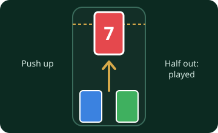

# Card Sling

A test game for card animations, not a real game: sling cards from your phone onto the pile on the board. For 1 to 8 players.

## In short

- Touch a card on your phone and push it up, off the top of the phone.
- The board shows the part that has left your phone, at your seat.
- Let go with half of it out, or flick it, and it flies onto the pile.
- **Draw a card** sends a card from the pile to your seat, and it comes in at the top of your phone.

## What happens

Any card may go on the pile at any time; there are no matching rules and no winner. AI players play one card each in turn, every few seconds, so you can see cards fly in from other seats too. The game ends after a number of cards.

## Settings

| Setting | Default | What it does |
|---|---|---|
| Seconds between AI moves | 3 | How often the next AI player plays or draws. |
| Cards played until the game ends | 100 | When the experiment stops. |
