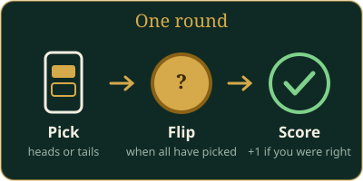

# Coin Flip

Guess heads or tails correctly more often than anyone else. For 1 to 8 players.

## In short

- Tap **Heads** or **Tails** on your phone before the time runs out.
- Every right guess scores one point.
- Most points after the last round wins.

## What you see

- **The board** shows the round, the coin, a countdown, and who has picked already (but not what). While the coin is in the air it shows everyone's pick, and ✓ or ✗ once it lands.
- **Your phone** has two big buttons, **Heads** and **Tails**, your score, the countdown and how your last pick went.

## How a round works

1. Tap **Heads** or **Tails**. You cannot change your pick.
2. The coin flips when everyone has picked, or when time runs out.
3. Everyone who guessed right gets 1 point. If you did not pick in time, you get nothing this round.
4. The next round starts right away.

The coin is fair: heads and tails are equally likely every time.

## Settings

| Setting | Default | What it does |
|---|---|---|
| Rounds | 3 | Number of flips (1–20) |
| Seconds to guess (0 = no limit) | 15 | Time to pick each round, in steps of 5 |

With no limit, the coin waits until everyone has picked.

AI players pick heads or tails at random.

## Players joining and leaving

- New players can sit down during the game. They start with 0 points.
- If your phone goes away or you leave, your seat waits for you: when there is a time limit, the coin flips without your pick. The board can exchange you for another person or an AI player.

## End of the game

After the last round, the player with the most correct guesses wins. Players with the same top score share the win. If nobody guessed right, there is no winner.

The result screen shows for each player: correct guesses, how often they picked heads and tails, and their heads percentage.
