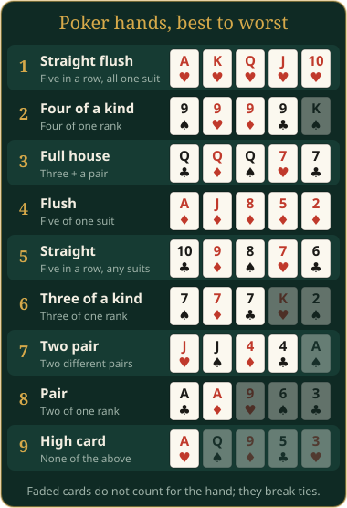

# Hold'em

Win the most points by making the best poker hand, or by getting everyone else to fold.

This is fixed-limit Texas Hold'em: every bet and raise has a set size. For 2 to 8 players. Points have no real-world value.

## What you see

- **The board** shows the five shared cards, the pot, each player's bet, the dealer button **D**, and whose turn it is. Other players' cards stay face down until the showdown.
- **Your phone** shows your two private cards, the shared cards, the pot, your points and your best hand so far. On your turn, the buttons appear.

Never show your phone to the others: your two cards are only there.

## How a hand works

1. The two players after the dealer post the **blinds**: half the small bet (rounded down), then one small bet. With two players, the dealer posts the smaller blind.
2. Everyone gets two private cards. The first betting round starts with the player after the big blind.
3. **Flop:** three shared cards. Betting round.
4. **Turn:** a fourth shared card. Betting round.
5. **River:** a fifth shared card. Last betting round.
6. **Showdown:** all remaining hands are shown on the board and the best hand wins the pot.

After the flop, betting starts with the first player after the dealer. The dealer button moves one player clockwise each hand.

## Your turn

| Button | What it does |
|---|---|
| Fold | Give up this hand |
| Check / Call | Pass, or match the current bet |
| Bet / Raise | Put in one more bet |

The button shows the exact amount you will pay now. **Fold** is greyed out when you can check for free.

### Bet sizes and the cap

- Before the flop and on the flop, a bet is the **small bet**.
- On the turn and river, a bet is **twice the small bet**.
- At most four bets per round (the big blind counts as the first one before the flop). Then the raise button says **Capped**.

### All-in and side pots

If you do not have enough points to call, you can call with everything you have. You are then **all-in**: you stay in the hand but bet no more. You can only win as much from each player as you put in. The rest goes to side pots for the others.

An all-in that adds less than half a bet does not let players who already acted raise again.

## Winning a hand

- Your hand is the best five cards out of your two and the five shared cards.
- If hands are the same kind, the higher cards win. If they are equal, the pot is split. An odd point goes to the first winner after the dealer.
- An ace counts high, or low in A-2-3-4-5.
- If everyone else folds, you win the pot and your cards are not shown.

## Time limit

With a time limit, a countdown runs on your turn. When it runs out, you check if that is free; otherwise you fold.

## Settings

| Setting | Default | What it does |
|---|---|---|
| Starting points | 500 | Points each player starts with |
| Small bet (big blind) | 10 | Bet size; doubles on turn and river |
| Hands to play | 20 | Number of hands (1–200) |
| Seconds per decision (0 = no limit) | 30 | Time for each decision |
| Seconds to show each result | 8 | Pause before the next hand |

AI players can be *tight* (plays only good hands) or *loose* (plays more hands and raises more often).

## Players out and leaving

- With no points left, you are out and sit out the remaining hands.
- If you leave, your hand is folded and your points are out of the final ranking.

## End of the game

The game ends after the last hand, or when fewer than two players have points. The player with the most points wins. Players with the same top score share the win.

## Tips

> Folding weak starting hands saves points. Pairs and two high cards are worth playing.
