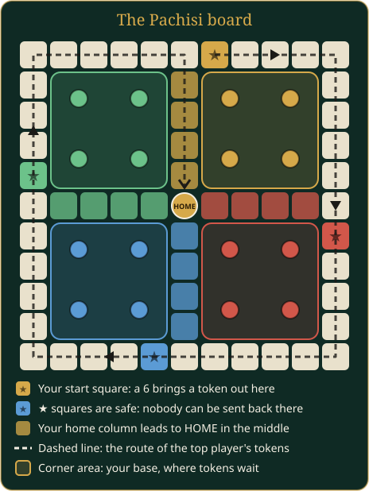

# Pachisi

Be the first to bring all your tokens around the board and into the home space in the middle. For 2 to 4 players.

## In short

- Roll the die on your phone, then move a token: on the phone, or tap it on the board.
- You need a 6 to bring a token out of your base. A 6 gives you another roll; three sixes in a row end your turn.
- Land on other players' tokens to send them back to their base, except on the ★ squares.
- Go around the track and up your home column, landing exactly on HOME. First with all tokens home wins.

## What you see

- **The board** shows the track, everyone's tokens, the die, whose turn it is and a log of the last moves. Tokens that can move bob up and down.
- **Your phone** has the **Roll the die** button and a list of your tokens. Each token shows where it is and, after you roll, where it would go.
- **Sounds** on the board: the die rattling, tokens stepping along, a chime for a 6, and a falling slide when a token is sent back. Sound effects can be turned off in the board's settings.

## The board

- Each player owns one side of the board, the side where they sit. Your base is the corner area in your colour.
- With two players, they always get **opposite** sides, so neither starts just ahead of the other.
- The **track** is the ring of 40 squares around the edge. Everyone moves clockwise.
- Your **start square** is in your colour, just past the middle of your side.
- The four **★ squares** are safe. They are the four start squares, including those of empty sides.
- Your **home column** is the row of 4 squares in your colour that leads from the middle of your side to HOME.

A token goes once around the track, from your start square to the square just before it. Then it turns into your home column and on to HOME.

## How a turn works

1. Tap **Roll the die** on your phone.
2. If a token can move, tap **Move** next to the one you want on your phone, or tap the token itself on the board, as you would pick it up at a real table. Only your tokens that can move answer a tap. A remote player taps the token on their own copy of the board.
3. The token moves forward by the number you rolled.
4. If you rolled a 6, you roll again. Otherwise the next player clockwise takes a turn.

If none of your tokens can move, your turn simply ends, even after a 6.

## Rules

- **Leaving the base:** you need a 6 to move a token from your base onto your start square.
- **Exact finish:** a token must land exactly on HOME. If the roll would take it past HOME, it cannot move.
- **Three sixes:** if you roll a 6 three times in a row, your turn ends at once. Moves you already made with the first two sixes stay.
- **Sending tokens back:** if your token lands on a track square with other players' tokens, all of them go back to their base. This does not give you an extra roll.
- **Safe squares:** nobody can be sent back on a ★ square. Tokens of different players can share it.
- Tokens in a home column are always safe.
- Your own tokens can share a square.

Who starts: the player with the bottom side of the board. If nobody has it, the first player clockwise from the top starts. Then play goes clockwise around the board.

## Time limit

With a time limit, a countdown runs on your turn. If it runs out, the table rolls for you. If you still do not choose, the table moves a token for you with a sensible choice. Each step gets its own countdown.

## Settings

| Setting | Default | What it does |
|---|---|---|
| Tokens per player | 4 | Tokens each player races (1–4) |
| Seconds per move (0 = no limit) | 30 | Time for each roll and each move |

AI players come in two levels: *beginner* (moves any token at random) and *average* (prefers finishing, leaving the base, sending others back and safe squares).

In the board's settings (the gear): **Pieces** shows icons on the tokens (the default), a smiley, a star, a bullseye and a moon, the same four for everyone and in each player's colour, on the board and on the phones; or numbers 1 to 4. Player colours are chosen there too, for every game at the table.

## Players leaving

A game keeps its players. If someone has to go, the board can exchange them for another person or an AI player, who plays on with the same tokens.

## End of the game

The game ends as soon as one player has every token at HOME. That player wins. There are no second places.

## Tips

> A 6 is precious: use it to bring a new token out, or to escape when someone is close behind you. Parking on a ★ square keeps you safe.
