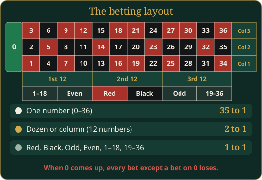

# Roulette

Finish the last spin with more points than anyone else at the table.

This is European roulette with one zero. Everyone bets at the same time from their phone, then the wheel spins. For 1 to 6 players. Points have no real-world value.

## In short

- Pick a chip on your phone and tap the bets you want, then tap **Done betting**.
- The wheel spins when everyone is done or the time runs out.
- A number pays 35 to 1, a dozen or column 2 to 1, red/black, odd/even and 1–18/19–36 pay 1 to 1.
- Zero is green: only a bet on 0 wins then.
- Most points at the end wins.

## What you see

- **The board** shows the wheel, the betting layout with everyone's chips in their seat colour, the last numbers and a countdown.
- **Your phone** shows your points, the chip sizes, the bets you can tap, and the result of each spin for you.

## How a round works

1. Betting opens and the countdown starts.
2. Pick a chip size (10, 25, 50, 100, 250 or 500).
3. Tap a bet to put that chip on it. Tap again to add more. The points leave your balance right away.
4. Tap **Clear** to take all your bets of this spin back.
5. Tap **Done betting** when you are finished. With no bets the button says **Skip this spin**.
6. The wheel spins when everyone has tapped Done, or when time runs out.
7. Winning bets are paid. Your phone shows the number and your result once the wheel on the board has stopped.
8. After a short pause the next spin's betting opens.

After Done you cannot change your bets until the next spin.

## Bets and payouts

| Bet | Wins on | Pays |
|---|---|---|
| A number | that number, 0–36 | 35 to 1 |
| Dozen | 1–12, 13–24 or 25–36 | 2 to 1 |
| Column | Col 1, 2 or 3 | 2 to 1 |
| Red or Black | that colour | 1 to 1 |
| Odd or Even | that kind of number | 1 to 1 |
| 1–18 or 19–36 | that half | 1 to 1 |

"35 to 1" means you win 35 times your bet and also get your bet back. Losing bets are gone.

**Zero is green.** It is not red or black, odd or even, low or high, and it is in no dozen or column. When 0 comes up, only a bet on 0 wins.

There are no split, corner or other combination bets.

### Limits

- Each bet must be at least the **Minimum bet**. Chips below it, or above the maximum, are hidden.
- The total on one spot in one spin cannot go over **Maximum bet per spot**.
- You cannot bet more points than you have.

## Settings

| Setting | Default | What it does |
|---|---|---|
| Spins | 10 | Number of spins (1–50) |
| Starting points | 1000 | Points each player starts with |
| Minimum bet | 10 | Smallest bet allowed |
| Maximum bet per spot | 1000 | Most you can have on one spot per spin |
| Seconds to bet | 25 | Length of the betting window (5–120) |
| Seconds to show the result | 7 | Time from the spin to the next betting window |

The wheel takes about 5 seconds to stop, and that time counts toward **Seconds to show the result**. Below about 6 seconds, the next betting window opens before you can read the result.

AI players can join with a play style: *conservative* (small bets, mostly on red, black, odd, even, low or high, now and then a dozen or a number), *aggressive* (bigger bets, often on numbers, dozens or columns) or *erratic* (anything goes). Each AI player has a favourite even-money bet and a lucky number of its own.

## Players joining and leaving

- New players can sit down during the game. They start with the starting points.
- If you leave, your bets for the current spin are removed and you are out of the final ranking.
- If you run out of points, you sit out. The game does not wait for you.

## End of the game

The game ends after the last spin, or earlier when nobody has enough points left for the minimum bet. The player with the most points wins. Players with the same top score share the win. **Statistics** on the board shows how everyone played: points, bets, spins won, the biggest win and the longest winning streak, what the wheel did (red and black, the longest red and black streaks, zeros, the hottest number), and awards such as *Odd Man* (bet on odd the most), *Seeing Red*, *Night Owl* (black), *Bullseye* (hit a single number the most), *Hot Hand* (most spins won in a row), *Jackpot* (biggest win on one spin) and *Wallflower* (sat out the most spins).

## Tips

> Even-money bets (red, black, odd, even, low, high) win almost half the time and keep you in the game longer. A single number rarely hits, but pays big.
